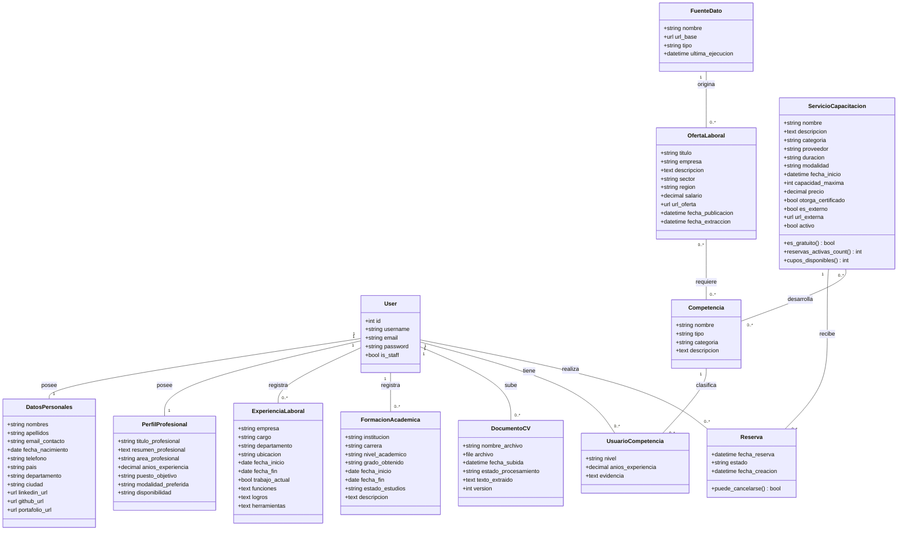
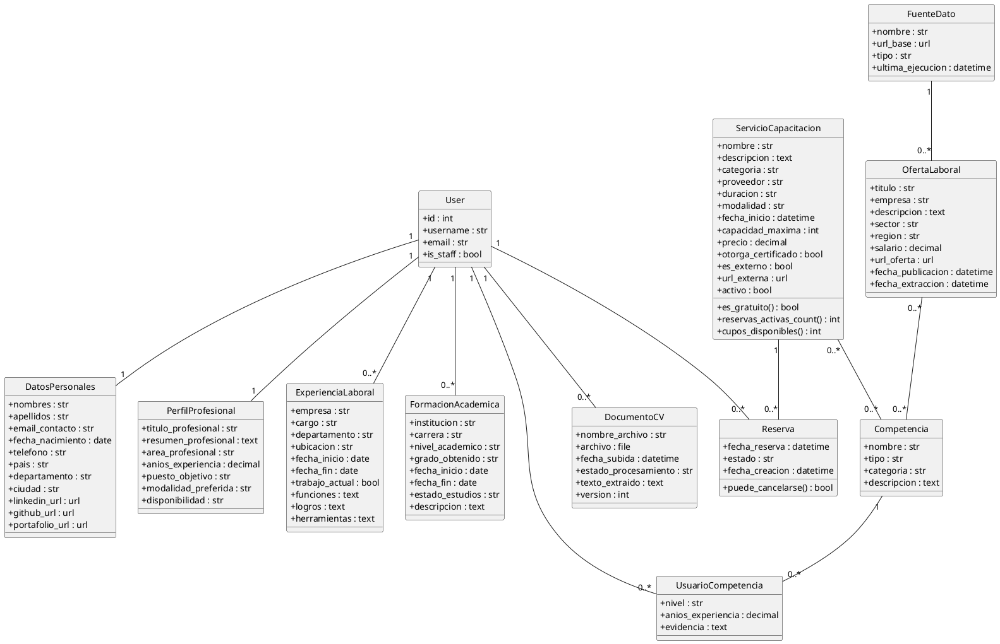

# Diagrama de Clases UML — EmpleoPredict

A continuación se presenta el diagrama de clases UML actualizado de los modelos en `core/models.py` en dos formatos listos para usar en tu informe o herramientas de diagramación: **Mermaid** (renderizable en Markdown/GitHub/VS Code) y **PlantUML** (compatible con PlantUML/Draw.io).

---

## 1. Código UML en Mermaid

---

## 2. Código UML en PlantUML (para exportar a imagen PNG/SVG)

