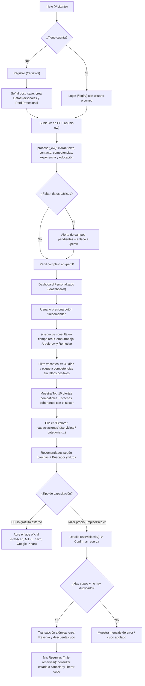

# Documentación Técnica — EmpleoPredict

## 1. Descripción General
**EmpleoPredict** es una plataforma web desarrollada en **Python** con **Django** (arquitectura MVT: Model–View–Template) orientada a resolver la problemática de **empleabilidad y brechas de competencias** de forma multisectorial (Derecho, Administración, Contabilidad, Educación, Salud, Ingeniería, Tecnología, Marketing, Oficios y Empleabilidad).

Permite a los usuarios registrarse, subir su Curriculum Vitae en PDF, extraer automáticamente sus datos y competencias, editar su perfil profesional universal, consultar ofertas laborales recientes extraídas en tiempo real según su perfil, identificar brechas y acceder a capacitaciones gratuitas o talleres con reserva de cupos.

---

## 2. Estructura del Proyecto y Función de Cada Archivo

### Configuración principal (`config/`)
- **`config/settings.py`**: Configuración global de Django (`INSTALLED_APPS`, base de datos SQLite `db.sqlite3`, idioma `es`, rutas de archivos `media/`, `LOGIN_URL = '/login/'`, `LOGIN_REDIRECT_URL = '/'`, `LOGOUT_REDIRECT_URL = '/'`).
- **`config/urls.py`**: Enrutador principal del proyecto; conecta `/admin/` y delega todas las rutas de la aplicación a `core/urls.py`, además de servir archivos de `MEDIA_URL` en modo desarrollo (`DEBUG=True`).

### Aplicación principal (`core/`)
- **`core/models.py`**: Define los 10 modelos relacionales del sistema y sus señales:
  - **Perfil Universal:** `DatosPersonales`, `PerfilProfesional`, `ExperienciaLaboral`, `FormacionAcademica`.
  - **Competencias y CV:** `Competencia`, `UsuarioCompetencia`, `DocumentoCV`.
  - **Extracción de Ofertas:** `FuenteDato`, `OfertaLaboral`.
  - **Capacitaciones y Reservas:** `ServicioCapacitacion`, `Reserva`.
  - **Señal `crear_perfil_usuario` (`post_save` en `User`):** Crea automáticamente registros iniciales de `DatosPersonales` y `PerfilProfesional` al registrarse un usuario.
- **`core/forms.py`**: Formularios Django con validación en servidor y estilos Tailwind CSS (`_aplicar_estilos_tailwind`):
  - Autenticación: `LoginForm` (acepta usuario o correo electrónico), `RegistroForm` (basado en `UserCreationForm`).
  - CV y Perfil: `SubirCVForm` (valida extensión `.pdf` y tamaño ≤ 10 MB), `DocumentoCVEditarForm`, `DatosPersonalesForm`, `PerfilProfesionalForm` (años de experiencia ≥ 0), `ExperienciaLaboralForm`, `FormacionAcademicaForm`, `UsuarioCompetenciaForm` y `UsuarioCompetenciaEditarForm`.
  - Reservas: `ReservaForm` (valida fecha/hora futura).
- **`core/utils.py`**: Motor de procesamiento de CV en PDF:
  - `extraer_texto_pdf`: Lee todas las páginas del PDF usando `pypdf.PdfReader`.
  - `extraer_datos_contacto`: Detecta email, teléfono celular, LinkedIn y GitHub mediante expresiones regulares (`re`).
  - `extraer_competencias_del_texto`: Identifica competencias del catálogo evitando falsos positivos (coincidencia exacta de palabra para herramientas/técnicas y raíz morfológica limpia en habilidades blandas largas).
  - `extraer_bloques_texto` y `procesar_cv`: Orquestan la extracción en transacción atómica (`transaction.atomic()`) actualizando `DatosPersonales`, `UsuarioCompetencia`, `ExperienciaLaboral` y `FormacionAcademica`.
- **`core/scraper.py`**: Motor de extracción de ofertas laborales en tiempo real (costo \$0):
  - `scrapear_computrabajo`: Extrae ofertas multisectoriales en español con `requests` + `BeautifulSoup`, obteniendo título, empresa, región, enlace (`url_oferta`) y fecha relativa (`_parsear_fecha_relativa_es`).
  - `importar_arbeitnow` e `importar_remotive`: Consumen APIs públicas gratuitas en JSON filtrando vacantes con antigüedad ≤ 30 días.
  - `obtener_terminos_busqueda_usuario`: Construye términos dinámicos desde `puesto_objetivo`, `titulo_profesional`, `area_profesional`, sinónimos sectoriales (`MAPA_SINONIMOS_SECTOR`) y competencias técnicas.
  - `recomendar_ofertas_para_usuario` y `_guardar_ofertas`: Ejecutan la búsqueda en tiempo real y guardan ofertas nuevas sin duplicados, asociando sus competencias.
- **`core/views.py`**: Controladores MVT que conectan formularios, modelos y plantillas:
  - Autenticación: `login_view`, `registro_view`.
  - CV y Perfil: `subir_cv_view`, `editar_cv_view`, `reprocesar_cv_view`, `eliminar_cv_view`, `perfil_view`, y endpoints CRUD de experiencia, formación y competencias (`editar_*`, `eliminar_*`), además de alertas de datos básicos faltantes (`_obtener_datos_basicos_faltantes`).
  - Dashboard personalizado: `dashboard_view` (`@login_required`) y `recomendar_ofertas_view` (`POST /dashboard/recomendar/`). Filtra ofertas recientes (≤ 30 días) por sector/competencias y calcula brechas coherentes con la profesión (`_obtener_categorias_usuario`, `_competencia_pertinente_al_sector`).
  - Capacitaciones y Reservas: `servicios_view` (catálogo, filtros, buscador y recomendador por brechas `_recomendar_servicios_para_usuario`), `servicio_detalle_view`, `reservar_servicio_view` (con `transaction.atomic()` y `select_for_update()`), `mis_reservas_view` y `cancelar_reserva_view`.
- **`core/urls.py`**: Mapeo completo de URLs de la aplicación.
- **`core/admin.py`**: Registro y configuración visual de los 10 modelos en Django Admin.
- **`core/management/commands/`**:
  - `cargar_competencias.py`: Carga el catálogo multisectorial de competencias desde CSV (`data/`).
  - `scrapear.py`: Comando CLI para ejecutar scraping manual por fuente y palabra clave.
  - `poblar_servicios.py`: Carga el catálogo inicial de cursos gratuitos externos verificados y talleres propios.
- **Pruebas automatizadas**: `core/tests.py`, `core/tests_multisectorial.py` y `core/tests_servicios.py`.

### Plantillas Frontend (`templates/`)
- `templates/base.html`: Layout base con Tailwind CSS CDN, FontAwesome, barra de navegación condicional y sistema de alertas.
- `templates/core/inicio.html`: Página de bienvenida y llamados a la acción.
- `templates/core/login.html` y `templates/core/registro.html`: Formularios públicos de acceso y registro.
- `templates/core/subir_cv.html`: Carga, historial, renombrado, reprocesamiento y eliminación de CVs.
- `templates/core/perfil.html`: Edición completa de datos personales, perfil profesional, competencias, experiencia y formación académica.
- `templates/core/dashboard.html`: Dashboard personalizado con botón **Recomendar**, Top 10 vacantes recientes, brechas de competencias y gráficos con Chart.js.
- `templates/core/servicios.html`, `servicio_detalle.html` y `mis_reservas.html`: Catálogo de capacitaciones, filtros, detalle, reserva de cupos y gestión de reservas.

---

## 3. Diagrama de Flujo del Sistema

